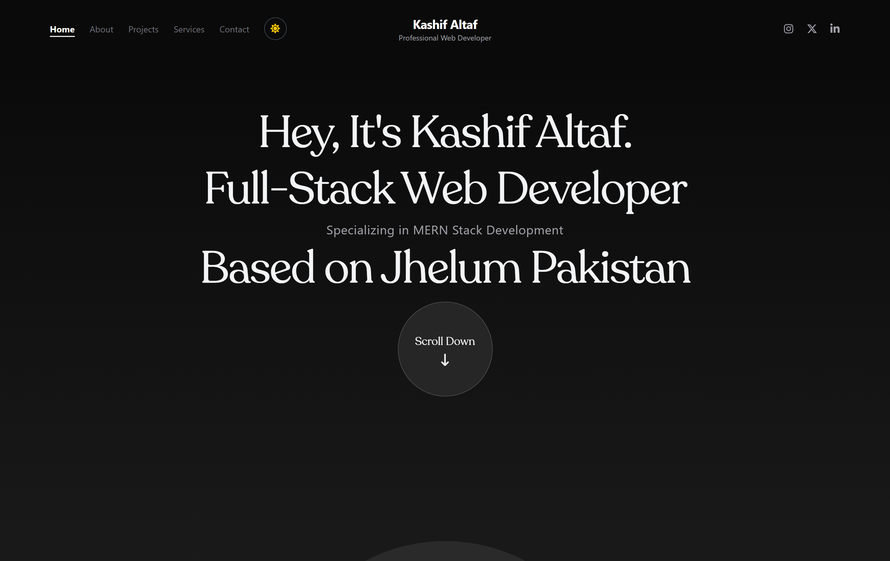
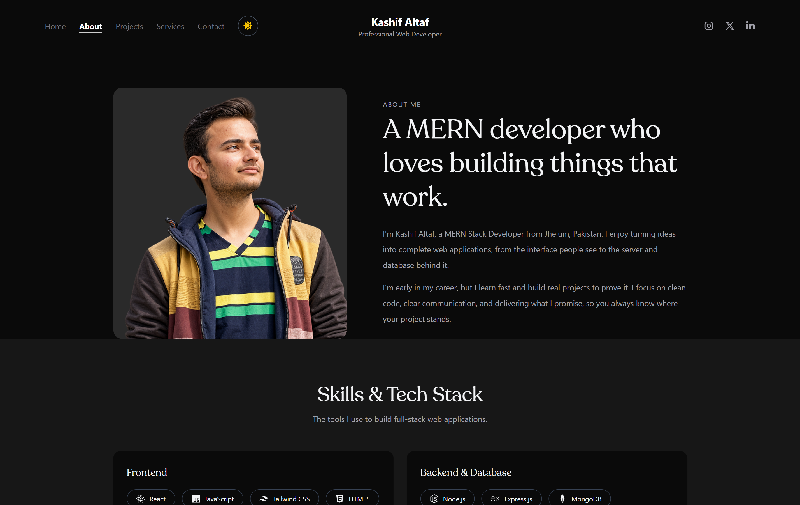
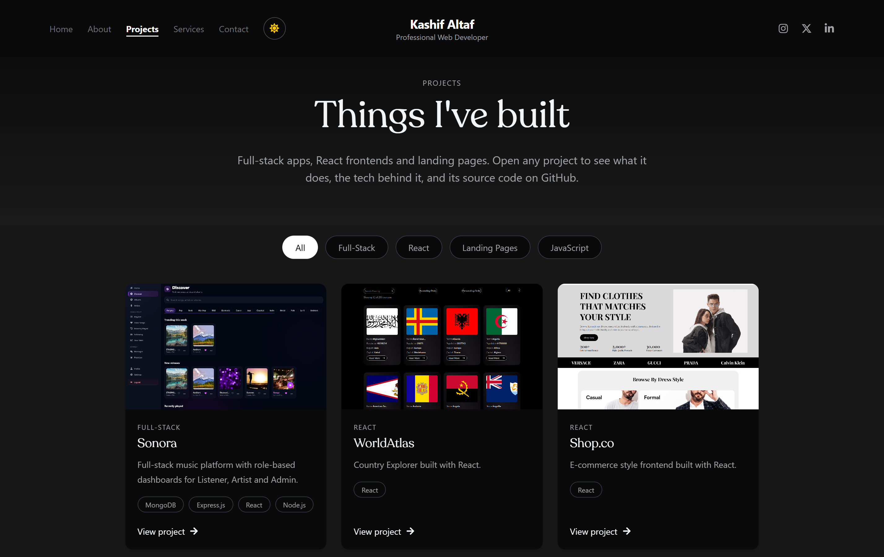
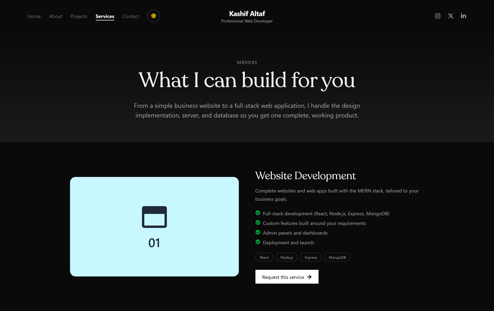
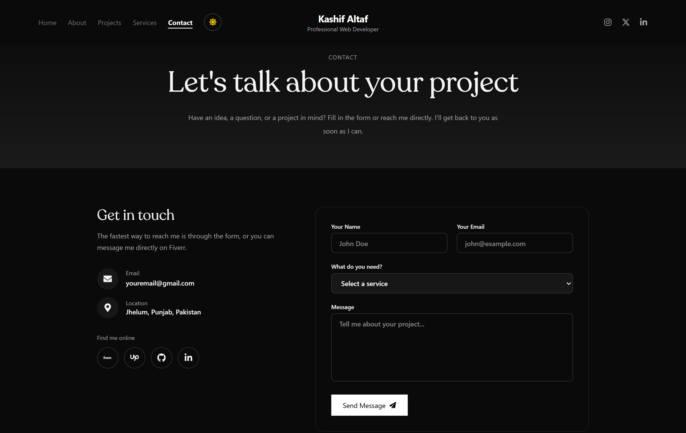

# Kashif Altaf | MERN Stack Developer

A personal developer portfolio showcasing my projects, technical skills, and services. Built with React, Vite, and Tailwind CSS.

**Live Website:** [kashif-portfolio-murex.vercel.app](https://kashif-portfolio-murex.vercel.app/)

## Overview

This portfolio presents my journey as a web developer, highlights selected projects, and provides a way to explore my work and get in touch.

The website includes dedicated pages for Home, About, Projects, Services, and Contact, along with individual project details.

## Screenshots

### Home



### About



### Projects



### Services



### Contact



## Tech Stack

- **Frontend:** React 19
- **Build Tool:** Vite
- **Styling:** Tailwind CSS v4
- **Routing:** React Router
- **Icons:** React Icons
- **Form Integration:** Formspree
- **Deployment:** Vercel

## Features

- Responsive portfolio layout
- Dedicated Home, About, Projects, Services, and Contact pages
- Individual project detail pages
- Project showcase with preview images
- Contact form integration
- Client-side navigation with React Router
- Deployed and hosted on Vercel

## Getting Started

Follow these steps to run the project locally.

### Prerequisites

- Node.js
- npm

### Installation

1. Clone the repository:

   ```bash
   git clone https://github.com/AweSomiseD/Kashif-Portfolio.git
   ```

2. Navigate to the project directory:

   ```bash
   cd Kashif-Portfolio
   ```

3. Install dependencies:

   ```bash
   npm install
   ```

4. Create a `.env` file in the project root and configure the contact form endpoint:

   ```env
   VITE_FORM_ENDPOINT=your_form_endpoint
   ```

5. Start the development server:

   ```bash
   npm run dev
   ```

### Production Build

To create a production build:

```bash
npm run build
```

The generated production files will be available in the `dist` directory.

## Deployment

This project is deployed on [Vercel](https://vercel.com/). The GitHub repository is connected to Vercel for automatic deployments whenever changes are pushed to the `main` branch.

## Repository

[GitHub - AweSomiseD/Kashif-Portfolio](https://github.com/AweSomiseD/Kashif-Portfolio)

---

**Built by Kashif Altaf**  
MERN Stack Developer | Jhelum, Punjab, Pakistan
